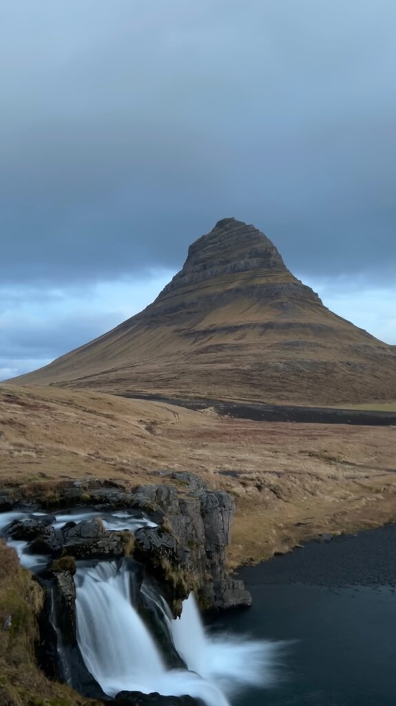
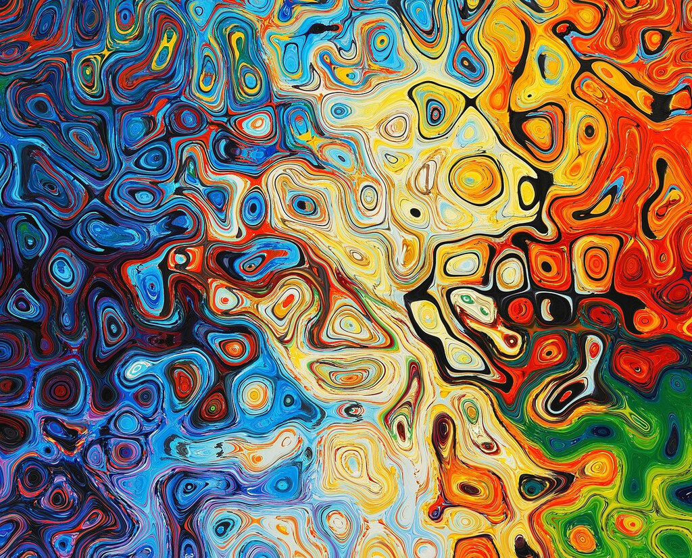
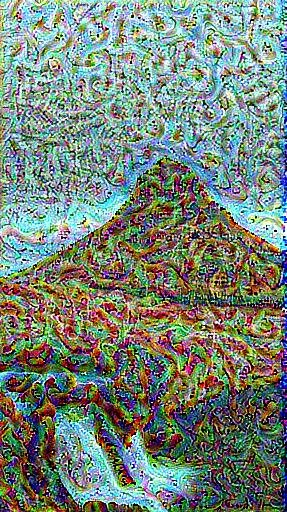
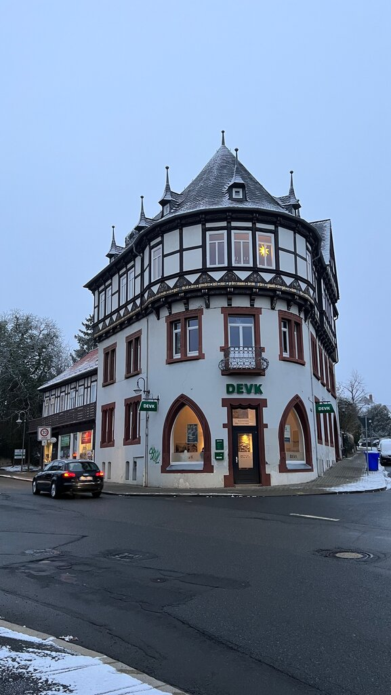
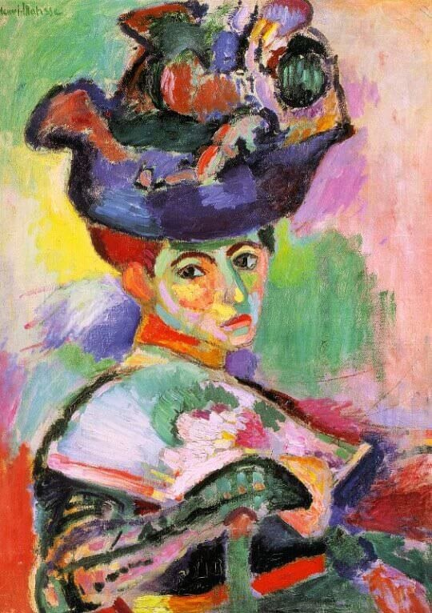
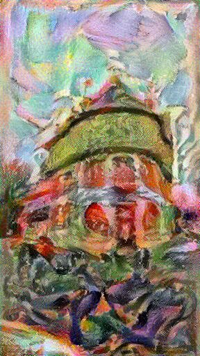
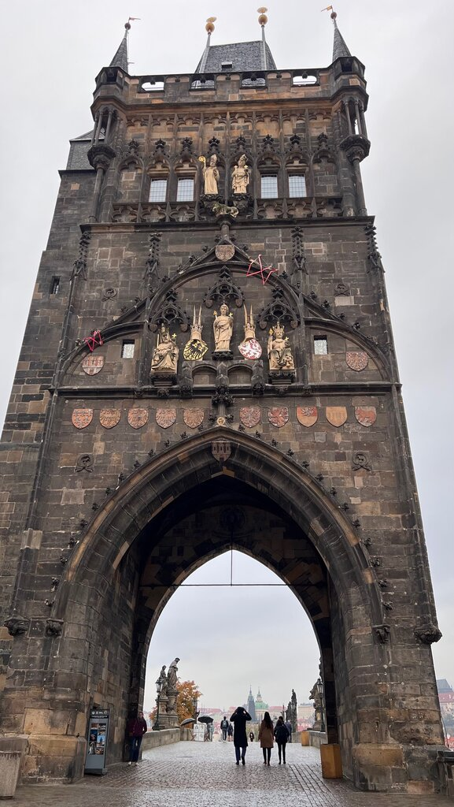
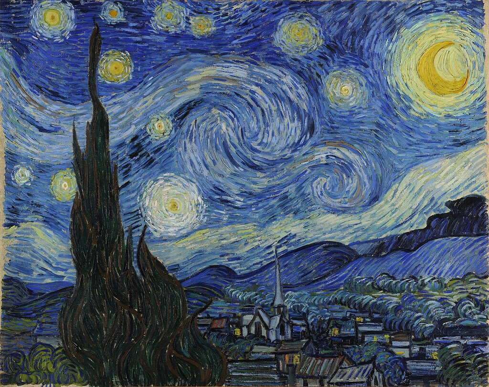
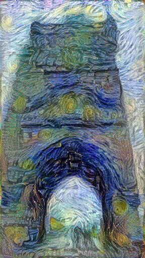

# Neural Style Transfer 🎨

Re-paints a photo in the style of an artwork with the optimisation-based method of Gatys et al. (2015), *A Neural Algorithm of Artistic Style*. A pretrained **VGG19** extracts content and style features, and the output image is optimised directly with Adam to match both. A total-variation term keeps the result smooth.

Built during the Deep Learning course at TU Braunschweig (2022). Experiments ran on the university's GPU cluster via SLURM.

## Results

| Content | Style | Result |
|:---:|:---:|:---:|
|  |  |  |
|  |  |  |
|  |  |  |

## How it works

- **Content representation:** activations of VGG19 layer `block4_conv2`.
- **Style representation:** Gram matrices (feature correlations) of `block1_conv1` … `block5_conv1`.
- **Loss:** `content_weight · content_loss + style_weight · style_loss + tv_weight · total_variation`.
- **Optimisation:** the image itself is the trainable variable (Adam, lr 0.02). Loss and intermediate images are logged to TensorBoard.

## Repository structure

```
├── src/neural_style_transfer.py     # command-line script
├── notebooks/neural_style_transfer.ipynb   # exploration, weight experiments, TensorBoard
├── scripts/slurm_job.sh             # example SLURM job for a GPU cluster
└── images/example_*/                # content, style and result images
```

## Usage

```bash
pip install -r requirements.txt
python src/neural_style_transfer.py \
    --content images/example_3/content.jpg \
    --style images/example_3/style.jpg \
    --output result.jpg --loops 100
tensorboard --logdir logs   # watch the image evolve
```

Useful knobs: `--style-weight`, `--content-weight`, `--tv-weight`, `--max-dim`. A GPU is strongly recommended.

## References

- L. A. Gatys, A. S. Ecker, M. Bethge, [*A Neural Algorithm of Artistic Style*](https://arxiv.org/abs/1508.06576), 2015.
- TensorFlow tutorial: [Neural style transfer](https://www.tensorflow.org/tutorials/generative/style_transfer).
- Style images: Vincent van Gogh and Henri Matisse, *Woman with a Hat* (1905), both public domain. Texture image from Pixabay.

## License

MIT
